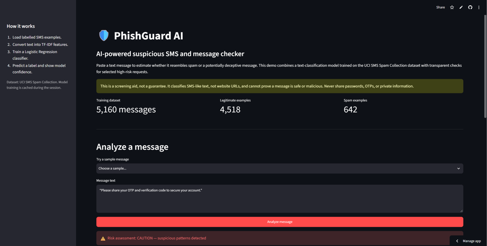
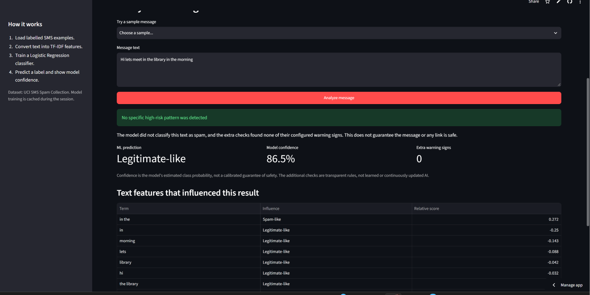
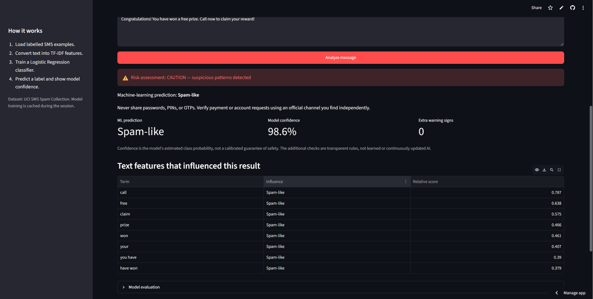
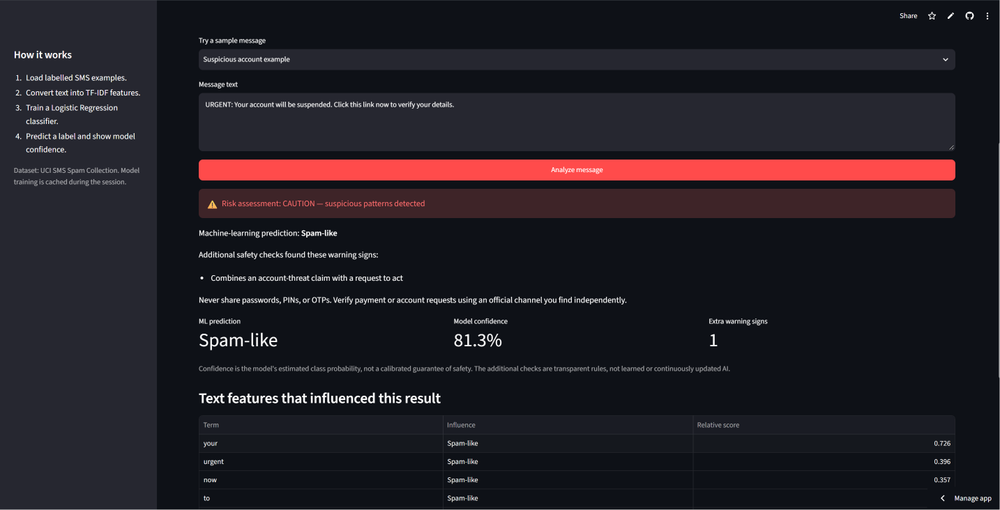

# PhishGuard AI 🛡️

An educational AI/ML application that classifies SMS-like text as **spam-like** or **legitimate-like**. It combines a TF-IDF + Logistic Regression classifier trained on the UCI SMS Spam Collection dataset with transparent, rule-based checks for selected suspicious message patterns.

> **Important:** This is a screening aid, not a security guarantee. It classifies SMS-like message text, not URLs or websites. A legitimate-like prediction does not mean a message is safe.

## Features

- Analyze a message or try built-in examples.
- Predict a spam-like or legitimate-like class.
- Show estimated model confidence and influential text features.
- Check selected high-risk patterns such as requests for OTPs/passwords, delivery-related payments, upfront job fees, links paired with account actions, and suspicious remote-app installation requests.
- Keep the heuristic rules separate and unit-testable in `risk_checks.py`.
- Show the ML prediction separately from additional warning signs.
- Display dataset label counts, held-out evaluation metrics, and a confusion matrix.
- Cache the loaded dataset and trained model for the Streamlit session.

## Demo and screenshots

**Demo video:** [Watch the PhishGuard AI demo on GitHub](demo/demovideo-phishguard.mp4)

### Application screenshots

**1. App home**


**2. Message analysis**


**3. Analysis results**


**4. Evaluation view**


## Tech stack

- Python
- Streamlit
- Pandas and NumPy
- scikit-learn: TF-IDF + Logistic Regression
- Matplotlib
- Python `unittest` for rule-check tests

## Run locally

1. Install Python 3.10–3.12.
2. Clone the repository and enter the folder:

   ```bash
   git clone https://github.com/pratham655/PhishGuard-AI.git
   cd PhishGuard-AI
   ```

3. Create and activate a virtual environment (optional but recommended).

   **Windows PowerShell**
   ```powershell
   py -3.12 -m venv .venv
   .\.venv\Scripts\Activate.ps1
   ```

   **macOS/Linux**
   ```bash
   python3 -m venv .venv
   source .venv/bin/activate
   ```

4. Install dependencies and start the app:

   ```bash
   pip install -r requirements.txt
   streamlit run app.py
   ```

The app downloads the public dataset from the UCI Machine Learning Repository on first use, so an internet connection is required. Streamlit caches the loaded dataset and trained model.

## Testing

Run the rule-check test suite using Python's built-in `unittest` module:

```bash
python -m unittest discover -s tests -v
```

**Latest reported local test run: 6 tests passed.** The tests cover benign college and family messages, delivery-payment warnings, links paired with account actions, OTP requests, and upfront job fees.

These tests cover selected heuristic rules only. They do not establish real-world scam-detection accuracy or validate every possible message.

## How it works

1. Downloads the UCI SMS Spam Collection dataset.
2. Removes duplicate/empty messages and separates message text from its `ham`/`spam` label.
3. Uses a stratified 80/20 train/test split.
4. Converts messages to TF-IDF unigram and bigram features.
5. Trains a Logistic Regression classifier with balanced class weights.
6. Evaluates on held-out examples and reports accuracy, precision/recall/F1, and a confusion matrix.
7. Returns a predicted class, estimated probability, and weighted terms that influenced the prediction.
8. Runs separate rule-based checks for selected suspicious patterns and displays those warnings independently from the ML prediction.

## Dataset and citation

Almeida, T. A., Gómez Hidalgo, J. M., & Yamakami, A. (2011). *Contributions to the Study of SMS Spam Filtering: New Collection and Results*. UCI Machine Learning Repository: [SMS Spam Collection](https://archive.ics.uci.edu/dataset/228/sms+spam+collection).

## Deliverables checklist

- [x] Public GitHub repository
- [x] Streamlit application source
- [x] Setup and usage instructions
- [x] Rule-check unit tests (6 passed locally)
- [x] Demo video added to the repository
- [x] Four application screenshots added to the repository
- [ ] Add the deployed Streamlit URL if deployment is part of the submission

## Limitations

- The dataset contains SMS messages; performance may differ on modern messaging apps, other languages, or new scam styles.
- TF-IDF and Logistic Regression can make false-positive and false-negative predictions.
- The extra safety checks are simple rules, not another AI model. They cover selected patterns only; attackers can reword messages, links can be deceptive in ways these rules do not detect, and legitimate messages can match a rule.
- Model confidence is not a calibrated measure of real-world safety.
- Never paste passwords, OTPs, personal data, or confidential messages into a demo.
